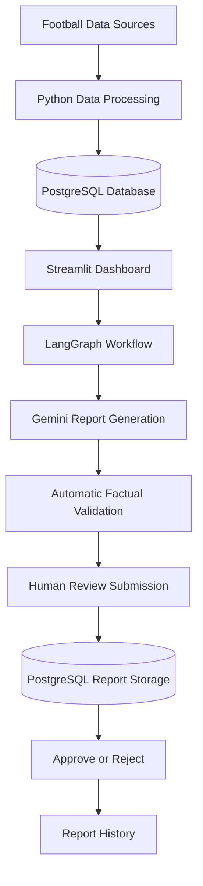

# ScoutMonitor AI — System Architecture

## 1. Project Overview

ScoutMonitor AI is a football intelligence application built with Python, LangGraph, Google Gemini, PostgreSQL, and Streamlit.

The application monitors football player statistics, produces AI-assisted scouting reports, validates factual information, and requires human review before reports are finalized.

The current application runs locally and has been demonstrated using stored football statistics and synthetic test data.

## 2. High-Level Architecture

This diagram illustrates the overall system flow rather than every internal LangGraph branch.

## 3. Technologies

| Technology | Purpose |
|---|---|
| Python | Core application logic |
| PostgreSQL | Store player statistics and reports |
| LangGraph | Coordinate the AI workflow |
| Google Gemini | Generate structured scouting reports |
| Streamlit | Provide an interactive dashboard |
| Pytest | Run automated tests |
| Git and GitHub | Version control and project documentation |

## 4. Data Processing

The project supports stored football statistics and synthetic demonstration data.

Player information and statistical observations are stored in PostgreSQL.

The application distinguishes between four data states:

- COMPLETE: Required statistics are available.
- PARTIAL: Some statistics are missing.
- NOT_REPORTED: Statistics have not been reported.
- NOT_COLLECTED: No observation has been stored.

Missing values are not automatically interpreted as zero.

## 5. LangGraph Workflow

The Streamlit dashboard imports the compiled graph from:

`scripts/scout_structured_graph.py`

The workflow contains nodes for:

- Fetching player data
- Checking performance changes
- Preparing summaries
- Creating alert drafts
- Generating structured AI reports
- Validating generated reports

The workflow routes detected changes to alert preparation and other monitoring states to factual summaries. Both paths proceed to structured report generation and factual validation.

## 6. AI Report Generation

The application uses Google Gemini to generate structured reports from available player evidence.

Reports may contain:

- Player ID
- Snapshot date
- Goals
- Assists
- Monitoring status
- Written analysis

When historical information is unavailable, the application can return WAITING_FOR_HISTORY instead of inventing a performance comparison.

## 7. Automatic Validation

Generated reports undergo factual checks against stored evidence.

The dashboard displays whether validation has passed.

A factual validation PASS does not mean the narrative has received human approval.

## 8. Human Review

Reports are submitted for human review rather than automatically published.

The review workflow supports:

- Pending reports
- Human approval or rejection
- Reviewer identification
- Review timestamps
- Report history
- Duplicate-report prevention

Review information is stored in PostgreSQL.

## 9. Local Verification

The following functionality has been demonstrated locally:

- Player statistics displayed in Streamlit
- Structured AI report generation
- Factual validation
- Human approval
- Report persistence in PostgreSQL
- Retrieval of approved reports
- Duplicate-report prevention

Six automated tests have also passed.

These checks demonstrate working local functionality, not full production readiness.

## 10. Current Limitations

- The application currently requires local configuration.
- Historical player statistics may be incomplete.
- Broader automated testing is needed.
- Deployment and security require further verification.
- External data usage must respect applicable licensing terms.
- Production authentication and operational controls are not yet verified.

## 11. Future Improvements

- Reproducible deployment using Docker
- Additional automated integration tests
- Broader football data coverage
- More advanced player comparison
- Automated monitoring schedules
- Enhanced scouting visualizations
- Security and performance testing
- A publicly accessible demonstration

## 12. Project Status

ScoutMonitor AI currently demonstrates a working local AI-assisted football monitoring and human-review workflow.

The repository documents a locally demonstrated engineering prototype, not a commercially deployed service.
