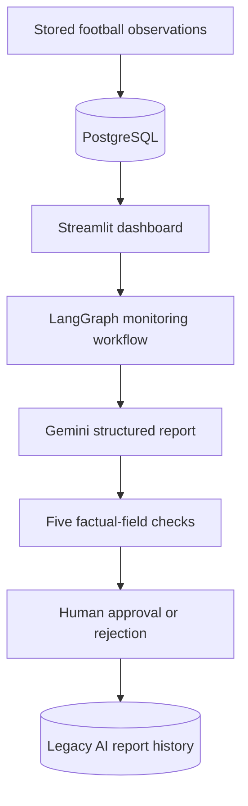
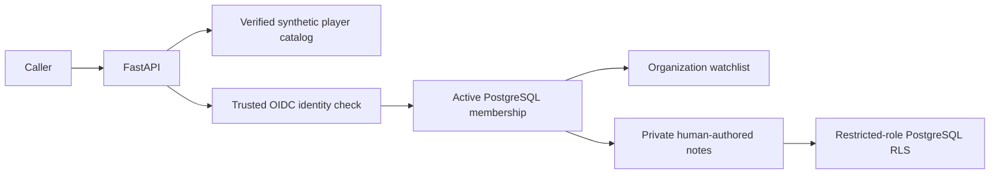

# ScoutMonitor AI — System Architecture

## Product boundaries

ScoutMonitor AI contains a locally demonstrated AI scouting workflow and a developing FastAPI backend. It is **not** a hosted multi-organization SaaS product. The Streamlit dashboard and legacy AI reports are not tenant-isolated and must not be made publicly accessible as customer features.

## Components

| Component | Responsibilities | Current scope |
|---|---|---|
| Python monitoring code | Read historical observations, detect changes, and prepare evidence summaries | Local workflow |
| LangGraph + Gemini | Generate structured report text from stored evidence | Local AI workflow, human review required |
| PostgreSQL | Persist player statistics, review records, and organization data | Legacy and new Alembic-managed schemas differ |
| Streamlit | Display historical statistics, generated report previews, and approval controls | Single local reviewer workflow |
| FastAPI | Synthetic player search/comparison, API health, membership-scoped watchlists and notes | Development backend |
| OIDC token verification | Verify trusted access-token signatures, issuer, audience, and expiry | Requires a configured external provider |
| Organization records and private notes | Organization memberships, roles, watchlists, and human-authored notes | New Alembic-managed databases; notes use restricted-role PostgreSQL RLS |
| GitHub Actions | Syntax, selected API tests, database migration and isolation tests | Automated checks on isolated synthetic data |

## Application data flows

### Legacy local scouting workflow

The workflow distinguishes `COMPLETE`, `PARTIAL`, `NOT_REPORTED`, and `NOT_COLLECTED` data states. A valid structured report can still contain unsupported narrative claims, so a human reviewer must inspect it. No report should be published automatically. The legacy table contains no organization ownership, and is **not** suitable for direct multi-tenant access.

### Developing API foundation

The synthetic API is read-only and is not an authorized commercial sports-data source. Private notes require a dedicated, non-superuser database connection. PostgreSQL RLS adds a safeguard but does not protect against direct SQL execution with compromised database credentials.

## Database schema evolution

- `docs/schema.sql` is a legacy PostgreSQL 18 schema export.
- Alembic revision `0001` creates the core tables in a **new empty** database.
- Revision `0002` adds organizations, external identities, memberships, and watchlists.
- Revision `0003` adds human-authored private notes, restrictions, and row-security policies.

Never stamp, migrate, or overwrite a legacy local database without an independently reviewed backup and data-adoption procedure. The safe demonstration database is `scoutmonitor_demo`.

## Data provenance

A database name is not proof of where its records came from. The monitoring workflow labels `scoutmonitor_demo` as fictional demonstration data; other databases use a neutral label until per-observation provenance is implemented. Missing football statistics must remain unknown, not become zero. Provider licenses and commercial redistribution rights must be verified before real customer use.

## Quality assurance and limits

The latest previously verified suite covered 38 API/data/security tests and 24 isolated PostgreSQL integration tests. Additional provenance tests are introduced in the current maintenance work. The GitHub workflow previously installed only test-specific dependencies; a full runtime dependency smoke check is being added.

Passing these checks does **not** establish that the entire LangGraph/Gemini/Streamlit customer journey works for external users. Required further verification includes real identity-provider integration, report ownership, authorization across all data paths, full workflow testing, backups and recovery, cloud operations, performance, and licensing.

## Next development direction

Follow [Product Development Roadmap](product-development.md) for acceptance-based milestones and the guided local implementation process. Prioritize an isolated reproducible development setup, one working end-to-end synthetic scouting/review journey, and a customer-facing Next.js interface connected to real API functionality before commercial deployment.
